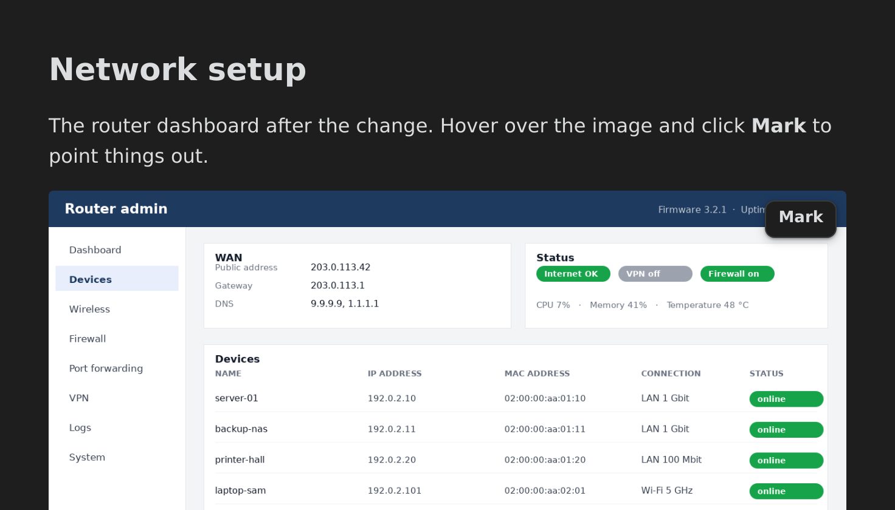
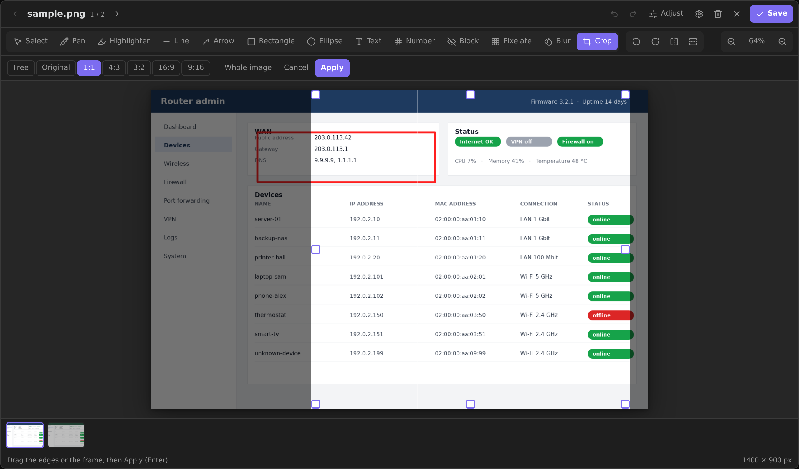
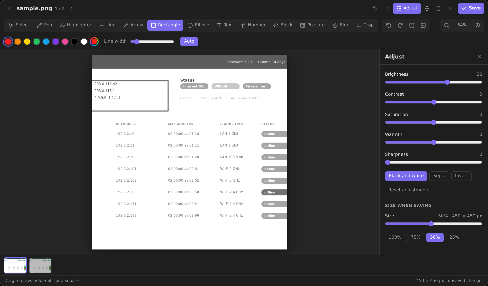
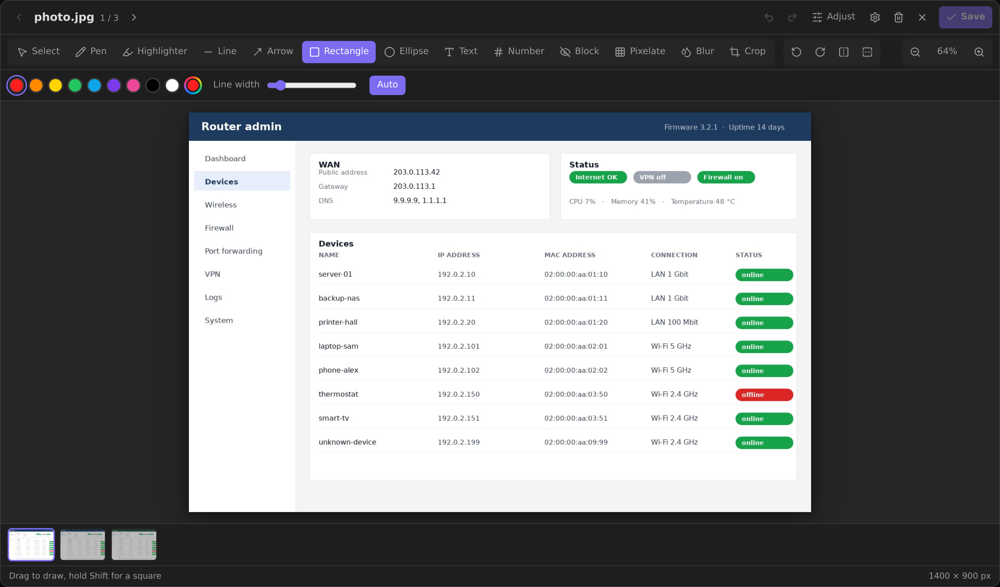
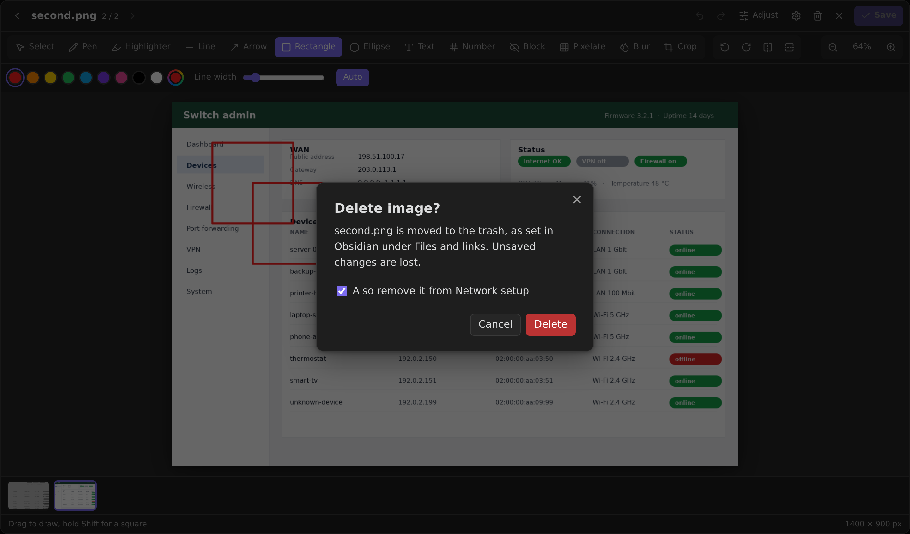
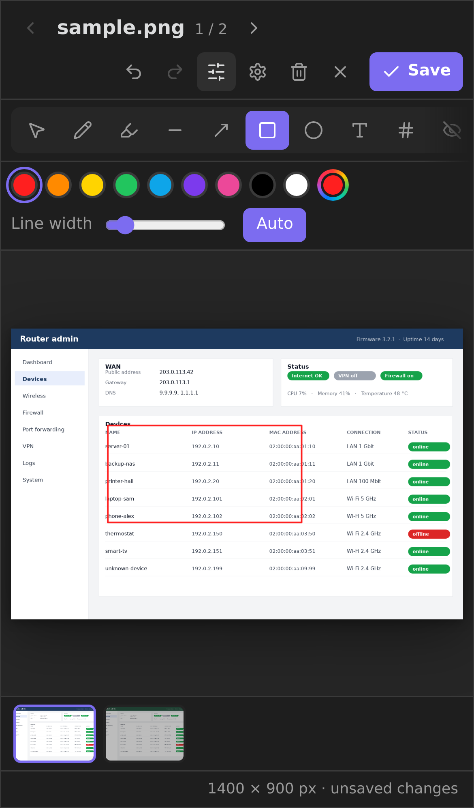
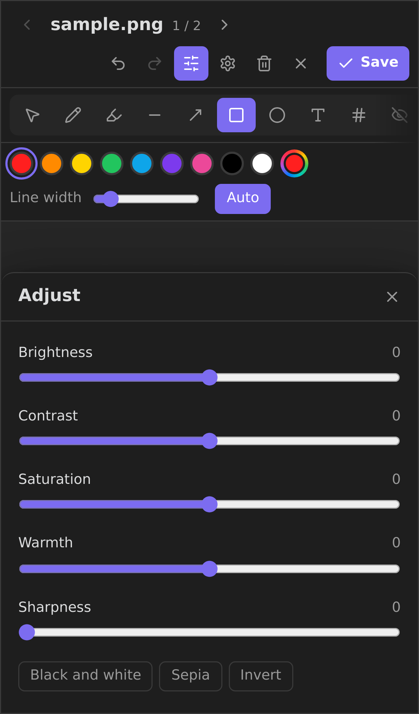
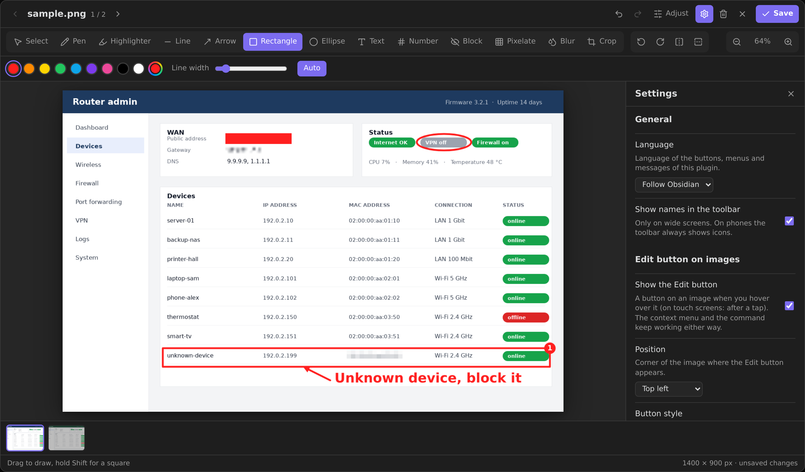

# PhotoMark+

## ⚠️ PLUGIN IN EARLY STAGES
## [REPORT ANY ISSUE HERE AND I WILL FIX IT](https://github.com/VBV11/photomark-plus/issues)

A fast photo editor inside your notes. Hover over an image, click **Edit**, and crop, rotate, adjust, draw, highlight, add text and arrows, or hide what nobody else should see. Then save, go to the next image, or delete one. You never leave Obsidian.

Works on desktop and on mobile, in reading view and in Live Preview.


## Why

Screenshots and photos in notes often need a quick fix: crop away the taskbar, turn a photo the right way up, point at a button, number the steps of a guide, or hide a password, an address or a face. Doing that in a separate image editor, exporting and re-embedding breaks your flow. PhotoMark+ edits the image where it is and saves it straight back into the vault.

## Features

- **Edit button on every image.** In the top left corner when you hover over an image (on touch screens: tap the image first). Another corner or only an icon is one setting away.
- **13 tools:** select, pen, highlighter, line, arrow, rectangle, ellipse, text, numbered marker (counts up by itself), solid block, pixelate, blur and crop. Hold Shift for straight lines, squares and circles.
- **Change what you drew.** With the select tool you move a mark, give it another color or width, or delete it. Click a text with the text tool to edit it.
- **Rotate and flip.** Marks turn with the image.
- **Crop** with a free frame or a fixed ratio: original, 1:1, 4:3, 3:2, 16:9 or 9:16.
- **Adjust** brightness, contrast, saturation, warmth and sharpness, or make it black and white, sepia or inverted.
- **Resize** when saving, from 5 to 100 percent.
- **Browse like a gallery.** Previous and next (or ← and →) go through the images in the note, with thumbnails at the bottom. Opened from the file explorer, you browse the images in that folder.
- **Delete an image** from the editor. It goes to the trash as set in Obsidian, and you can remove it from the note in the same step.
- **Settings right in the editor** (gear button), the same ones as in the settings tab.
- **Unlimited undo and redo**, zoom (buttons, Ctrl/Cmd + scroll, two fingers) and keyboard shortcuts for everything.
- **PNG, JPG and WebP.** Save in the same format or convert. PNG stays lossless and keeps transparency.
- **Private by design.** No network requests, no telemetry, no external libraries, and the plugin never lists your vault. One file of plain JavaScript.
- Interface in English and Dutch (follows the Obsidian language, or pick one in the settings).

## How to use

There are three ways to open the editor:

1. **Hover over an image** in a note and click **Edit** in its top left corner. On a phone or tablet, tap the image and then the button.
2. **Right-click** an image in the file explorer, or right-click a line in the editor that contains an image, and choose **Edit image**.
3. Run the command **PhotoMark+: Edit image** from the command palette. It opens the image on the current line, the image you are viewing, or lets you pick one from the note.



Pick a tool and drag on the image. For a numbered marker, click. For text, click and type; Enter places it. Click **Save** when you are done.

| Key | Action |
|---|---|
| `V` `D` `H` `L` `A` `R` `E` | Select, Pen, Highlighter, Line, Arrow, Rectangle, Ellipse |
| `T` `N` `B` `P` `U` `C` | Text, Number, Block, Pixelate, Blur, Crop |
| `Shift` while drawing | Straight lines (45°), squares and circles |
| `Delete` | Delete the selected mark |
| `[` `]` | Rotate left, rotate right |
| `Ctrl/Cmd+Z`, `Ctrl/Cmd+Shift+Z` or `Ctrl/Cmd+Y` | Undo, redo |
| `+` `-` `0` `1` | Zoom in, zoom out, fit, actual size. Also `Ctrl/Cmd` + scroll, or two fingers. Hold `Space` to pan. |
| `←` `→` | Previous or next image |
| `Enter` or `Ctrl/Cmd+S` | Save (in crop mode, `Enter` applies the crop) |
| `Esc` | Close (asks first when there are unsaved changes) |









The result is a normal image file, so it looks the same everywhere: in Obsidian, on your phone, in an export or on a published site.


 

## Settings

All settings are in Settings → PhotoMark+, and also in the editor itself behind the gear button.



| Setting | Default | What it does |
|---|---|---|
| **General** | | |
| Language | follow Obsidian | English or Dutch, independent of the Obsidian language. |
| Show names in the toolbar | on | Tool names next to the icons on wide screens. Phones always show icons. |
| **Edit button on images** | | |
| Show the Edit button | on | Turn off if you only want the context menu and the command. |
| Position | top left | Move the button to another corner if it covers a button of another plugin. |
| Button style | icon and text | Or only the pencil icon. |
| **Drawing** | | |
| Tool when the editor opens | rectangle | The editor remembers the tool you used last. |
| Color, highlighter color, block color | red, yellow, red | Also changeable in the editor; the last used color is remembered. |
| Line width | automatic | In image pixels. Automatic scales with the image (about 1/280 of the longest side). |
| Text size | automatic | In image pixels. |
| Background behind text | off | A box behind text, so it stays readable on busy screenshots. |
| **Saving** | | |
| When saving | overwrite | **Overwrite** replaces the file. **Copy** writes `name-edited.png` next to the original and updates the embeds in the note you started from. |
| File type | same as the original | Or PNG, JPEG or WebP. Another type is always saved as a new file next to the original, and the embeds are updated. |
| Suffix for copies | `-edited` | Used for copies and converted files. |
| JPEG and WebP quality | 92 | PNG is always lossless. |
| After saving | close the editor | Or keep editing, or go to the next image. |
| Ask before closing with unsaved changes | on | |
| **Browsing images** | | |
| Images to browse | the note, otherwise the folder | Or always the note, or always the folder. |
| Show thumbnails | on | |
| Unsaved changes when switching images | ask | Or save automatically, or discard. |
| **Deleting** | | |
| Ask before deleting | on | |
| Also remove the image from the note | on | Removes its embeds from the note you opened it from. |

## Installation

**Community plugins (recommended):** Settings → Community plugins → Browse → search for *PhotoMark+* → Install → Enable. (Available once the plugin is accepted into the community list.)

**With BRAT:** add `VBV11/photomark-plus` in the [BRAT](https://github.com/TfTHacker/obsidian42-brat) plugin.

**Manually:** download `main.js`, `manifest.json` and `styles.css` from the [latest release](https://github.com/VBV11/photomark-plus/releases/latest) into `<your vault>/.obsidian/plugins/photomark-plus/`, reload Obsidian and enable the plugin under Community plugins.

Requires Obsidian 1.5.0 or newer. Desktop and mobile.

## Good to know

- **Overwrite really overwrites.** The previous version of the image is gone unless you have File Recovery for attachments, Obsidian Sync, git or another backup. If you want to be safe, switch *When saving* to *Copy*.
- **Deleting** follows Obsidian's own setting (Files and links → Deleted files): system trash, the `.trash` folder of the vault, or permanently.
- Copies, converted files and deletions update the `![[...]]` and `` embeds in the note you opened the editor from. Other notes that embed the same image are not changed.
- Saving re-encodes the image. EXIF metadata (camera, location) is not kept; photo orientation is applied to the pixels, so the image looks the same.
- Block, pixelate and blur change the pixels of the saved file: what is underneath cannot be recovered from the image. Pixelate replaces every block by its average color. For passwords and other secrets a solid block is the safest choice.
- Images larger than 16 megapixels are refused: that is the canvas limit on iOS.
- On platforms that cannot write WebP (older iOS), a WebP image is saved as a PNG copy instead.

## Development

There is no build step: `main.js` is the source, written in plain JavaScript against the `obsidian` API. The plugin that Obsidian loads consists of three files: `main.js`, `manifest.json` and `styles.css`. Everything else in this repository is documentation and tests.

```sh
git clone https://github.com/VBV11/photomark-plus
cd photomark-plus
npm ci                      # Playwright, only needed for the tests
npx playwright install chromium
npm run build               # syntax check of main.js and the JSON files
npm test                    # 84 checks in headless Chromium against a mocked Obsidian API (test/mock-obsidian.js)
node test/run.js --shots    # also regenerates the screenshots in docs/
```

The screenshots in this README come from that test page, which imitates Obsidian's default dark theme. The sample "router dashboard" is generated by `test/make-sample.js`; every name and address in it is fictional.

To work on the plugin inside a vault, clone the repository into `<vault>/.obsidian/plugins/photomark-plus/` and reload Obsidian after each change.

**Releasing:** optionally add a section for the new version to `CHANGELOG.md` (it becomes the release notes), run `npm version patch` (or `minor`/`major`), which updates `manifest.json` and `versions.json`, commits and tags without a `v`, then `git push --follow-tags`. The GitHub Action checks the versions, attaches `main.js`, `manifest.json` and `styles.css` to a new release, and adds a [build provenance attestation](https://docs.github.com/en/actions/security-for-github-actions/using-artifact-attestations) for each file. Check one with `gh attestation verify main.js -R VBV11/photomark-plus`.

## License

[MIT](LICENSE)
