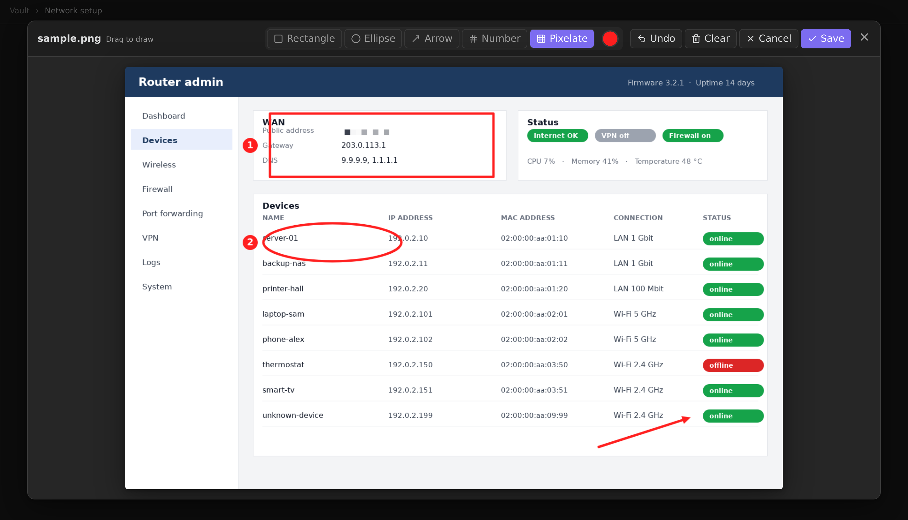
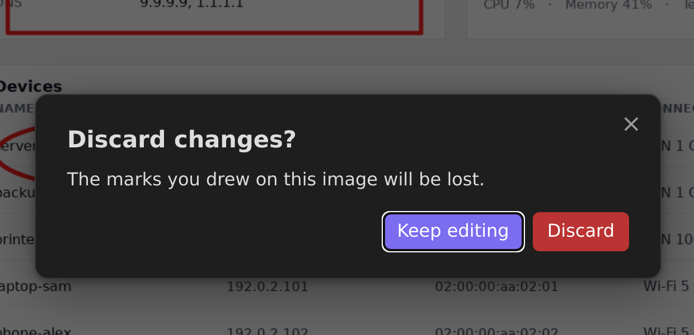
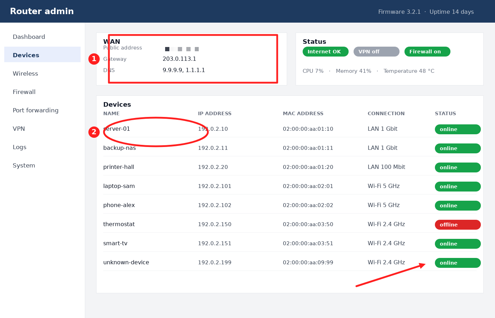

# PhotoMark+

Mark up images without leaving your notes. Hover over an image, click **Mark**, draw, save. That is the whole workflow.

Rectangles, ellipses, arrows, numbered markers and a pixelate tool for hiding passwords, addresses or faces. Works on desktop and on mobile, in reading view and in Live Preview.



## Why

Screenshots in notes often need a quick "look here": a box around a setting, an arrow pointing at a button, numbers for a step-by-step guide, or a blurred bit you do not want to share. Doing that in a separate image editor, exporting and re-embedding breaks your flow. PhotoMark+ edits the image where it is and saves it straight back into the vault.

## Features

- **Mark button on every image.** Appears in the top-right corner when you hover over an image (on touch screens: tap the image first).
- **Five tools:** rectangle, ellipse, arrow, numbered marker (counts up automatically) and pixelate.
- **Color picker** in the toolbar; the line width scales with the size of the image, or set a fixed width.
- **Undo, clear and keyboard shortcuts** for everything.
- **Two ways to save:** overwrite the original, or save a copy next to it and let the plugin update the embeds in your note.
- **PNG, JPG and WebP.** PNG stays lossless and keeps transparency.
- **Private by design.** No network requests, no telemetry, no external libraries. One file of plain JavaScript.
- Interface in English and Dutch (follows the Obsidian language setting, or pick one in the settings).

## How to use

There are three ways to open the editor:

1. **Hover over an image** in a note and click **Mark** in its top-right corner. On a phone or tablet, tap the image and then the button.
2. **Right-click** an image in the file explorer, or right-click a line in the editor that contains an image, and choose **Mark image**.
3. Run the command **PhotoMark+: Mark image** from the command palette. It opens the image on the current line, the image you are viewing, or lets you pick one from the note.


In the editor, pick a tool and drag on the image. For a numbered marker, just click. Click **Save** when you are done.

| Key | Action |
|---|---|
| `R` `E` `A` `N` `P` | Rectangle, Ellipse, Arrow, Number, Pixelate |
| `Ctrl/Cmd+Z` | Undo the last mark |
| `Enter` or `Ctrl/Cmd+S` | Save |
| `Esc` | Cancel (asks first if you drew something) |



The result is a normal image file, so it looks the same everywhere: in Obsidian, on your phone, in an export or on a published site.




## Settings

| Setting | Default | What it does |
|---|---|---|
| Default color | red (`#ff1f1f`) | Color for new marks. You can still change it in the editor; the last used color is remembered. |
| Line width | automatic | In image pixels. Automatic scales with the image (about 1/280 of the longest side, at least 3). |
| JPEG and WebP quality | 92 | Only applies to lossy formats. PNG is always lossless. |
| When saving | overwrite | **Overwrite** replaces the file. **Copy** writes `name-marked.png` next to the original and updates the embeds in the note you started from. |
| Suffix for copies | `-marked` | Only used in copy mode. |
| Show the Mark button on images | on | Turn off if you only want the context menu and the command. |
| Corner for the Mark button | top right | Move the button to another corner if it covers a button of another plugin. |
| Language | follow Obsidian | English or Dutch, independent of the Obsidian language. |

## Installation

**Community plugins (recommended):** Settings → Community plugins → Browse → search for *PhotoMark+* → Install → Enable. (Available once the plugin is accepted into the community list.)

**With BRAT:** add `VBV11/photomark-plus` in the [BRAT](https://github.com/TfTHacker/obsidian42-brat) plugin.

**Manually:** download `main.js`, `manifest.json` and `styles.css` from the [latest release](https://github.com/VBV11/photomark-plus/releases/latest) into `<your vault>/.obsidian/plugins/photomark-plus/`, reload Obsidian and enable the plugin under Community plugins.

Requires Obsidian 1.5.0 or newer. Desktop and mobile.

## Good to know

- **Overwrite really overwrites.** The previous version of the image is gone unless you have File Recovery for attachments, Obsidian Sync, git or another backup. If you want to be safe, switch *When saving* to *Copy*.
- In copy mode the plugin updates `![[...]]` and `` embeds in the note you opened the editor from. Other notes that embed the same image keep pointing at the original.
- Saving re-encodes the image. EXIF metadata (camera, location) is not kept; photo orientation is applied to the pixels, so the image looks the same.
- Images larger than 16 megapixels are refused: that is the canvas limit on iOS.
- On platforms that cannot write WebP (older iOS), a WebP image is saved as a PNG copy instead.

## Development

There is no build step: `main.js` is the source, written in plain JavaScript against the `obsidian` API. The plugin that Obsidian loads consists of three files: `main.js`, `manifest.json` and `styles.css`. Everything else in this repository is documentation and tests.

```sh
git clone https://github.com/VBV11/photomark-plus
cd photomark-plus
npm install                 # Playwright, only needed for the tests
npm test                    # 43 checks in headless Chromium against a mocked Obsidian API (test/mock-obsidian.js)
node test/run.js --shots    # also regenerates the screenshots in docs/
```

The screenshots in this README come from that test page, which imitates Obsidian's default dark theme. The sample "router dashboard" is generated by `test/make-sample.js`; every name and address in it is fictional.

To work on the plugin inside a vault, clone the repository into `<vault>/.obsidian/plugins/photomark-plus/` and reload Obsidian after each change.

Releasing: `npm version patch` (or `minor`/`major`) updates `manifest.json` and `versions.json`, commits and tags; `git push --follow-tags` then lets the GitHub Action publish the release with the three plugin files.

## License

[MIT](LICENSE)
